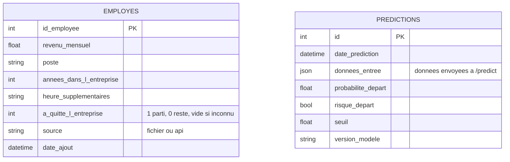

# TechNova Attrition API

Mise en production d'un modèle de machine learning qui prédit le risque de démission des employés de TechNova Partners.

Le modèle est un CatBoost entraîné sur les données RH de 1 470 employés (SIRH, évaluations annuelles et sondage interne). Sur le jeu de test, il détecte 79 % des départs avec un seuil de 0,36.

## Installation

Il faut avoir Git et uv installés.

    git clone https://github.com/Florentgs/technova-attrition-api.git
    cd technova-attrition-api
    uv sync

Sans uv : `pip install -r requirements.txt`.

## Entraîner le modèle

    uv run python -m scripts.train

Le modèle est enregistré dans `models/model.cbm`, et ses informations (version, seuil, colonnes, résultats sur le test) dans `models/model_info.json`.

## Lancer les tests

    uv run pytest --cov=app

## Lancer l'API

Créer un fichier `.env` à la racine (voir `.env.example`) avec une clé d'API :

    API_KEY=votre_cle

Puis lancer le serveur :

    uv run uvicorn app.main:app --reload

La documentation interactive (Swagger) est disponible sur http://127.0.0.1:8000/docs.

## Routes

- `GET /health` : vérifie que l'API fonctionne et donne la version du modèle (sans authentification).
- `POST /predict` : renvoie la probabilité de départ d'un employé à partir de ses données, et indique s'il est à risque (probabilité supérieure au seuil de 0,36).
- `POST /employes` : ajoute un employé dans la base. Le modèle n'est pas réentraîné : l'employé servira au prochain entraînement.

## Authentification et sécurité

La route `/predict` demande une clé d'API, envoyée dans l'en-tête `X-API-Key`. Sans clé valide, l'API répond 401. Dans Swagger, la clé se renseigne avec le bouton **Authorize**.

La clé est stockée dans le fichier `.env`, qui n'est pas versionné (il est dans le `.gitignore`).

Les données envoyées sont vérifiées par Pydantic (types, bornes, valeurs autorisées, cohérence des anciennetés). En cas d'erreur, l'API répond 422 en indiquant le champ concerné.

Exemple d'appel avec curl :

    curl -X POST http://127.0.0.1:8000/predict -H "X-API-Key: votre_cle" -H "Content-Type: application/json" -d @exemple.json

## Base de données

La base PostgreSQL contient deux tables :

- `employes` : données RH des employés (fichiers d'origine et employés ajoutés par l'API), utilisées pour entraîner le modèle ;
- `predictions` : chaque appel au modèle, avec les données envoyées, la probabilité, le résultat, le seuil et la version du modèle.

La liste complète des colonnes est dans `app/database.py`.

Création de la base, de l'utilisateur de l'API et insertion des employés (renseigner d'abord `DATABASE_URL` et `ADMIN_DATABASE_URL` dans `.env`) :

    uv run python -m scripts.create_db

L'API se connecte avec un utilisateur qui peut seulement lire et ajouter des lignes. Les identifiants de connexion sont dans `.env`, non versionné.

Exemples de requêtes et export des prédictions dans `exemples/predictions.csv` :

    uv run python -m scripts.requetes

Réentraîner le modèle à partir de la base (employés dont on sait s'ils sont partis ou restés) :

    uv run python -m scripts.train --base